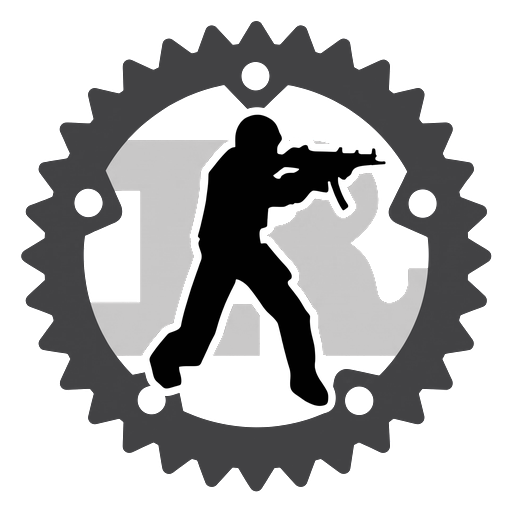
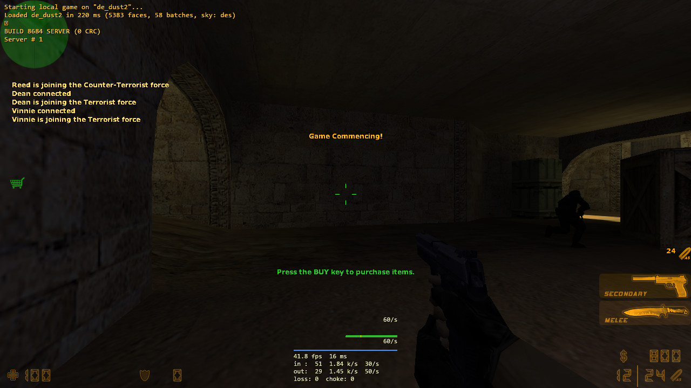
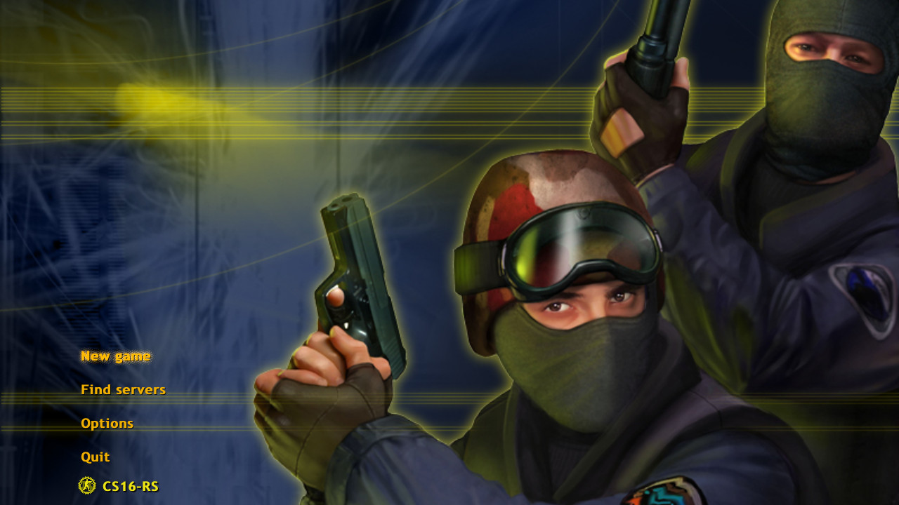
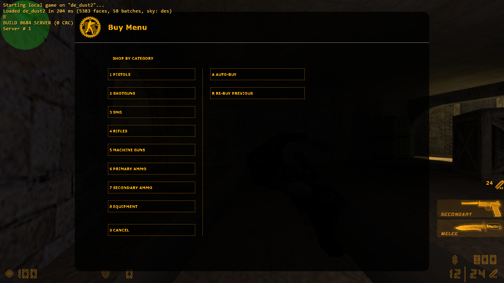
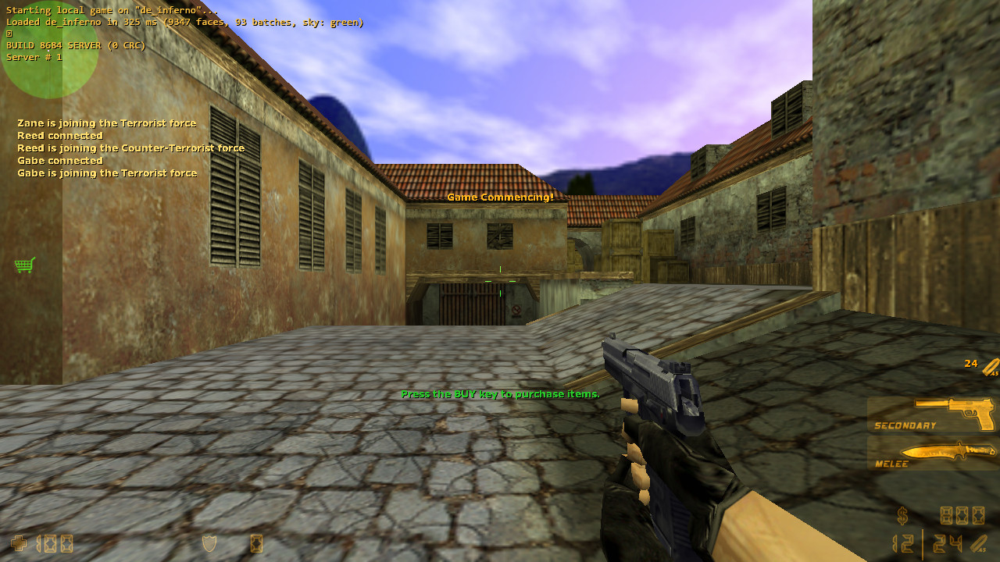
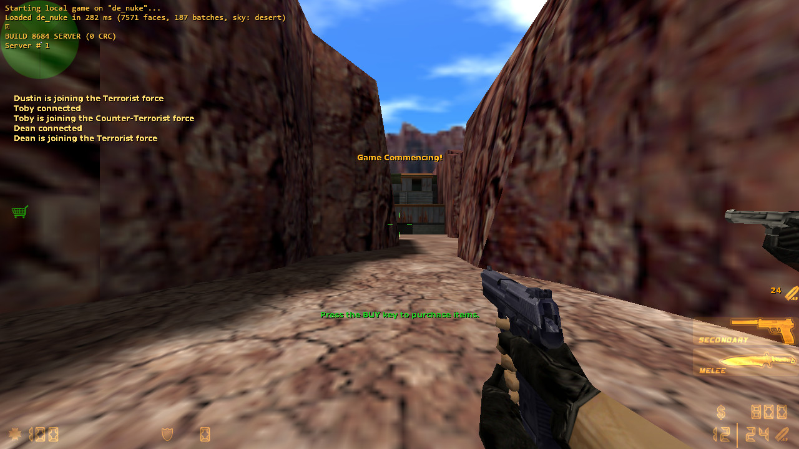
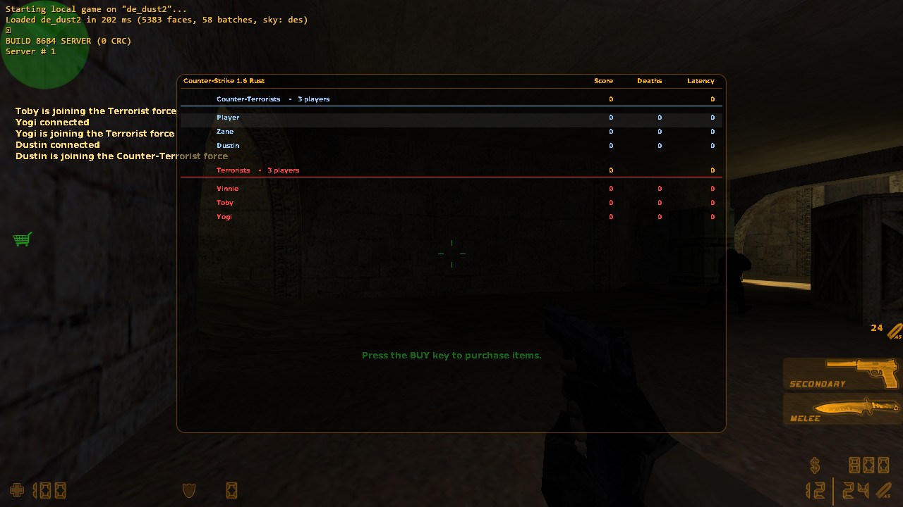
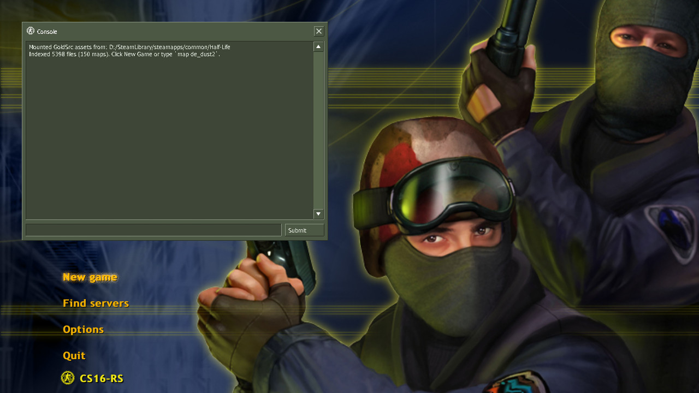
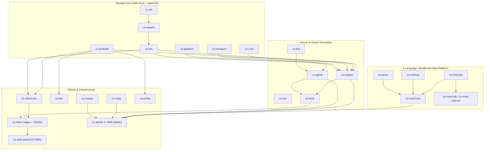

<div align="center">

<picture>
  <source media="(prefers-color-scheme: dark)" srcset=".github/assets/logo-dark.png">
  
</picture>

# cs16-rs

**Counter-Strike 1.6 & GoldSrc Protocol 48 reimagined in 100% Safe Rust (`#![forbid(unsafe_code)]`) — two-way compatible with retail Steam CS 1.6, playable natively or directly in the browser via WebGPU/WebGL2, and extensible in Rust, C++20, Go, Python 3, and `.amxx`.**

[](https://github.com/maybewewill/cs16-rs/actions/workflows/ci.yml)
[](https://github.com/maybewewill/cs16-rs/releases)
[](https://maybewewill.github.io/cs16-rs/)
[](LICENSE)
[](rust-toolchain.toml)
[](Cargo.toml)

[Play in Browser](https://maybewewill.github.io/cs16-rs/) · [Screenshots](#screenshots--footage) · [Releases](https://github.com/maybewewill/cs16-rs/releases) · [Quick Start](#quick-start) · [Modding (5 Languages)](docs/MODDING.md) · [Benchmarks](#performance--rewrite-advantages) · [Deployment](docs/DEPLOYMENT.md)

</div>

---

## Screenshots & Footage

<div align="center">
  
  <br>
  <sub><i>Unretouched 1280×720 real-time <code>wgpu</code> Vulkan capture on <code>de_dust2</code> using retail Steam assets, authentic HUD sprites, and GoldSrc <code>net_graph 1</code>.</i></sub>
</div>

<br>

| | |
|---|---|
| <br><sub><b>Main Menu</b> — <code>GameMenu.res</code> + transparent <code>cs16-rs</code> emblem</sub> | <br><sub><b>VGUI2 Buy Menu</b> — <code>Buy*.res</code> with amber <code>cs16-rs</code> crest</sub> |
| <br><sub><b>de_inferno</b> — BSP lightmaps, skybox &amp; weapon viewmodel</sub> | <br><sub><b>de_nuke</b> — Classic GoldSrc geometry &amp; HUD rendering</sub> |
| <br><sub><b>TAB Scoreboard &amp; ZBots</b> — <code>ScoreBoard.res</code> live match state</sub> | <br><sub><b>Developer Console</b> — Steam 2003 <code>TrackerScheme.res</code> chrome</sub> |

---

## Feature Highlights

- **Two-Way Protocol 48 Interoperability:** Retail Steam `hl.exe` connects to `cs-server`, and `cs-client` connects to retail `hlds.exe` (Steam Build 10210). Full `de_*` Bomb/Defusal, `cs_*` Hostage Rescue (`CLocalNav`), `as_*`/`es_*` VIP, HLTV proxy (`cs-hltv`), Master Server (`cs-master`), HLDEMO v5 `.dem` recording/playback, and 3-way Steam Voice `OPUS_PLC <-> CSVO ADPCM` bridging.
- **Authentic Steam Build 10210 Feel:** Shared `pm_shared` movement (`cs-pm`), all 28 weapons + Tactical Shield with ReGameDLL `KickBack` recoil, `160/160` map entity classes across all 25 stock maps, `735/735` vanilla CVars & console commands (including `wait` scripting and scroll-wheel bhop/duck impulse latching), VGUI2 `.res` & `TrackerScheme.res`/`ClientScheme.res` UI, `sniper_scope.spr`, `net_graph 1/2/3`, `cl_shadows 1`, `cl_minmodels 1`, and ZBot `.nav` AI with automatic BSP navmesh generation.
- **Browser PWA & 1-Click WebRTC P2P Rooms:** Full `wasm32-unknown-unknown` client running on WebGPU or WebGL2 (`https://maybewewill.github.io/cs16-rs/`). Mount your local Half-Life folder into browser IndexedDB (zero files uploaded), play offline 5v5 against ZBots, host a 1-click WebRTC DataChannel P2P room, or join any `wss://` server.
- **5-Language Sandboxed Modding Platform (ABI v2):** Run **Python 3** (zero-compile, `< 5 ms` live hot-reload), **Rust**, **C++20**, **Go/WASI**, and legacy **AMX Mod X (`.amxx` Pawn 3.2)** plugins side-by-side on the same 100 Hz server. Includes ReAPI `Pre`/`Post` hooks, 1-line `vfx_*`, paginated menus, bilingual `en`/`ru` `i18n`, RBAC admins, synchronous polyglot RPC, `< 10 ms` offline black-box crash replay (`cargo xtask mod replay`), and a 5-second legacy AMXX migrator (`--import-amxx`).
- **Built-In Server Operations:** Single-binary `cs-server` (`--admin`, `--embed-web`), official Docker image (`ghcr.io/maybewewill/cs16-rs`), and a Steam-2003 VGUI2 **Web Admin Panel (`/admin`)** with RCON terminal, live player/bot controls, match stats leaderboard, **10 Hz 2D HLTV-style Round Replay Viewer**, and **Mods & ResMon Studio** (live per-plugin CPU bars + browser editor).
- **Opt-In "Beyond 1.6" Practice, Scrim & KZ Suite:** Wallbang & nade trajectory lab (`sv_showimpacts`, `sv_grenade_trajectory`, `rethrow`), competitive scrim commands (`lo3`, `mp_knife_round`, `sv_damage_print`), built-in KZ checkpoints & `+32 u` LongJump stats (`sv_kz_mode`, `cl_ljstats`), and spectator `spec_xray` / `spec_hud_bars` — all disabled (`0`) by default so retail behavior stays untouched.

---

## Performance & Rewrite Advantages

All Phase 16 benchmarks below were measured deterministically on real Steam `de_dust2` assets (NVIDIA GeForce RTX 5070 Laptop GPU / Vulkan, unoptimized `dev` profile via `cargo xtask bench --suite all --gpu`; `[profile.release]` further enables `opt-level = 3`, `lto = "thin"`, `codegen-units = 1`). See the full technical breakdown in [`docs/REWRITE_ADVANTAGES.md`](docs/REWRITE_ADVANTAGES.md).

### Legacy GoldSrc (C/C++) vs `cs16-rs` (Safe Rust)

| Dimension | Legacy GoldSrc (`hl.exe` / `hlds.exe` / Metamod) | `cs16-rs` (Safe Rust) |
|---|---|---|
| **Memory & Security Safety** | Unmanaged C/C++; decades of buffer overflows, arbitrary file writes, and slowhack CVars | **`0 unsafe` blocks** across all 27 crates (321K LOC), `#![forbid(unsafe_code)]`, `cl_filterstuffcmd` enforcement, constant-time admin auth |
| **Rendering Pipeline** | 1998 OpenGL 1.1 fixed-function (`glBegin`/`glEnd`), CPU bone skinning, 1 draw call per smoke puff | `wgpu 30` (Vulkan / DX12 / Metal / WebGPU / WebGL2), GPU `.mdl` skinning (`<= 6 KiB` UBO), cached `GammaTables`, **1-draw-call smoke batching** (`45 -> 1` draw calls), **-95.9%** upload traffic (`1,825 -> 75 KiB/frame`) |
| **Headless GPU Frame Time (`de_dust2`, 16 MDL + 45 smokes)** | Legacy single-threaded GL driver overhead | **`13.82 ms -> 1.88 ms`** (**7.35x** Phase 16 speedup; **`532 FPS` in unoptimized `dev`**) with **`(-0.4, -0.8, +0.0)` RGB parity** vs retail CS 1.6 |
| **Protocol 48 Wire Delta Codec** | Pointer-driven C struct reflection | Zero-alloc `CompiledPlan` + stack `u64` bitmask: **`15,604 -> 3,422 ns/op`** (**4.56x**, **`292,197 entities/sec`** in `dev`, **0 B wire diff**) |
| **Server Startup & 32-Player Tick** | Multi-second map + bot init; single-threaded snapshot encoding | **`228.6 ms` cold startup** on 32p `de_dust2` + 31 ZBots; **`1.02 ms` avg / `1.87 ms` p99 tick** (`dev`); bit-packed `u64` PVS + deterministic multi-core snapshot compression |
| **Audio & Input Latency** | Shared-lock mixer; OS swapchain buffering | Lock-free audio thread + signon WAV warmup (`0.00 ms` round-1 hitch); `gl_vsync 0` + `gl_lowlatency 1`; **`416 -> 306 us`** client CPU (**1.36x**) |
| **Modding & Crash Isolation** | Native C++ `.dll`/`.so` + Pawn; one null deref crashes the whole server | Sandboxed **Rust, C++20, Go, Python 3, `.amxx`** with fuel/memory caps, `< 5 ms` live hot-reload, and `< 10 ms` offline `ModFaultDump` replay |
| **Platforms & Distribution** | x86 Windows / 32-bit Linux only | Windows x86_64, Linux / Steam Deck x86_64, macOS Apple Silicon, **Browser PWA (WebGPU/WebGL2 + WebRTC P2P)**, Docker (`ghcr.io`) |

---

## Quick Start

> **Assets notice:** Zero Valve assets are stored in this repository. `cs16-rs` mounts your existing Steam Half-Life / Counter-Strike 1.6 folder (`cstrike`, `valve`, `platform`, optional `cstrike_hd`) **read-only** at runtime (auto-discovered via Steam `libraryfolders.vdf`, or set via `--gamedir` / `CS16_GAMEDIR`).

### 1. Play Native (Offline 5v5 or Multiplayer)

Download a prebuilt archive from [GitHub Releases](https://github.com/maybewewill/cs16-rs/releases), or build from source (Rust `1.100.0` pinned via `rust-toolchain.toml`):

```bash
# Launch desktop client (auto-discovers Steam Half-Life install)
cargo run --release -p cs-client

# Jump directly into de_dust2 with classic net_graph 1
cargo run --release -p cs-client -- --map de_dust2 --exec "net_graph 1"

# Connect to any cs-server or retail HLDS server
cargo run --release -p cs-client -- --exec "connect 127.0.0.1:27015"
```

### 2. Play Directly in the Browser (WebGPU / WebGL2 PWA)

- **Instant Hosted Launcher:** Open **[https://maybewewill.github.io/cs16-rs/](https://maybewewill.github.io/cs16-rs/)** in Chrome, Edge, or Firefox -> mount your local `Half-Life` folder (cached locally in IndexedDB, never uploaded) -> click **Offline 5v5** or **Host P2P Room**.
- **Self-Hosted Web + Admin Server:**

```bash
cargo xtask web-build --release
cargo run --release -p cs-server -- \
  --map de_dust2 --port 27015 --web-port 27016 --web-dir dist/web --admin --bots 9
```

Open `http://127.0.0.1:27016/` to play in the browser, or `http://127.0.0.1:27016/admin` for the Web Admin Panel & ResMon Studio (authenticate with `rcon_password`). Add `--embed-web` to serve the launcher & admin UI directly from the single `cs-server` binary with no external `web/` directory.

### 3. Dedicated Server, Docker & 5-Second AMXX Migration

```bash
# Single-binary dedicated server with 5-language polyglot mods + Web Admin
cargo xtask mod build
cargo run --release -p cs-server -- \
  --map de_dust2 --port 27015 --maxplayers 16 --plugins-toml configs/plugins.toml --admin

# Or run via Docker Compose / GHCR
CS16_GAMEDIR=/srv/steam/Half-Life docker compose up -d

# Migrate an existing ReHLDS / AMX Mod X server in 5 seconds
cargo xtask import-amxx /path/to/cstrike/addons/amxmodx --out-dir .
```

Full deployment, reverse proxy, TLS (`wss://`), and Web Admin API documentation: [`docs/DEPLOYMENT.md`](docs/DEPLOYMENT.md).

### 4. Write a Plugin in 10 Lines (Python 3 or Rust)

Drop a zero-compile Python plugin into `mods/community/hello.py` (hot-reloads automatically on save with `sv_mod_autoreload 1`):

```python
from cs16 import mod, vfx, Color, HookAction

@mod.info(id="hello", version="1.0.0", permissions=["entities", "messages", "vfx", "commands"])
def _meta(): pass

@mod.chat_command("/rs")
def cmd_rs(player, args):
    player.reset_score()
    player.chat(f"{Color.GREEN}[RS]{Color.DEFAULT} Score reset for {player.name}!")
    vfx.aura_light(player.origin, radius=18, rgb=(255, 180, 30), life=6, decay=15)
    return HookAction.SUPERCEDE
```

Or scaffold a compiled, `#![forbid(unsafe_code)]` Rust WASM mod (`cargo xtask mod new hello --lang rust` — C++20 and Go also supported):

```rust
use cs_mod_sdk::{HookAction, HookId, HookPhase, HostBridge, Player, cs_mod_init, vfx};
cs_mod_sdk::cs16_wasm_host_bridge!();

#[cs_mod_init]
pub fn init(host: &mut impl HostBridge) -> i32 {
    host.hook_register(HookId::PlayerSpawn, HookPhase::Post, 0); 0
}
#[unsafe(no_mangle)]
pub extern "C" fn cs_mod_hook(hook_id: i32, phase: i32) -> i32 {
    let mut host = cs_mod_sdk::WasmHostBridge;
    if HookId::from_i32(hook_id) == Some(HookId::PlayerSpawn) && phase == HookPhase::Post as i32 {
        if let Some(pos) = Player::new(host.hook_arg_i32(0) as u8).origin(&host) {
            vfx::shockwave_ring(&mut host, pos, 160.0, [255, 176, 0, 220], 6, 12, None);
        }
    }
    HookAction::Continue as i32
}
```

Complete 5-language guide (Python, Rust, C++20, Go/WASI, `.amxx` + crash replay + ResMon): [`docs/MODDING.md`](docs/MODDING.md).

### 5. Opt-In "Beyond 1.6" Console Features

Every enhancement below defaults to **`0`**, keeping vanilla Counter-Strike 1.6 gameplay, HUD, and Protocol 48 wire traffic untouched until enabled:

| CVar / Command | Default | Effect |
|---|---:|---|
| `sv_showimpacts 1` | `0` | Server/client hit markers + wallbang material penetration & damage delta logger |
| `sv_grenade_trajectory 1` / `rethrow` | `0` | Live 3D grenade flight arcs + instant last-grenade replay for nade practice |
| `sv_showhitboxes 1` / `mp_buy_anywhere 1` | `0` | Render anatomical 6-hitbox overlays; allow buying anywhere on the map |
| `mp_warmup_mode 1` / `give_all` / `ammo_full` | `0` | Instant-respawn warmup with practice loadout commands |
| `lo3` / `mp_knife_round 1` / `sv_damage_print 1` | `0` | Competitive live-on-3 restart, knife round (`.stay`/`.switch`), round-end damage summary |
| `sv_kz_mode 1` / `cl_ljstats 1` | `0` | Kreedz `/cp`/`/tp`/`/stuck`/`/start` checkpoints + `+32 u` LongJump/LJ/HJ/CJ/BJ telemetry |
| `cl_showspeed 1` / `cl_showkeys 1` | `0` | Authentic `ClientScheme` horizontal speed (`u/s`) & live `WASD/JUMP/DUCK` overlay |
| `spec_xray 1` / `spec_hud_bars 1` | `0` | Spectator/demo wall-occluded Fresnel silhouettes & CT/T sidebar HP/money/weapon cards |
| `gl_vsync 0` / `gl_lowlatency 1` | `0` / `1` | Immediate swapchain presentation & single-frame scanout latency |

---

## Architecture



### Workspace Crates (27 Crates)

| Crate | Purpose |
|---|---|
| `cs-vfs` | Case-insensitive layered GoldSrc VFS (`mods/` -> `cstrike_downloads` -> `cstrike_hd` -> `cstrike` -> `valve` -> `platform`) + Steam auto-discovery & browser memory layers |
| `cs-cvar` | GoldSrc console & CVar engine (`735/735` parity): `bind`, `alias`, frame-deferred `wait`, `bindtoggle`, `incrementvar`, `FCVAR_*`, `config.cfg` |
| `cs-assets` | Pure-Rust parsers for `BSP v30`, `WAD3`, `MDL v10`, `SPR v2`, `.nav` v1–v5, `HPAK` sprays, `TrackerScheme`/`ClientScheme`, `.res`, `.scr`, UTF-16LE localization, overviews |
| `cs-proto48` | GoldSrc Protocol 48 wire framing, NetChan, precompiled `CompiledPlan` delta codec, user messages, HLDEMO v5 `.dem` |
| `cs-platform` | Native & `wasm32` clock, config storage, and XDG `nav_cache/` seams |
| `cs-transport` | Unified `PacketTransport` for UDP, loopback, `MultiPeerChannel` (WebRTC P2P), and pure-Rust RFC 6455 WebSocket + HTTP/1.1 |
| `cs-relay` | Hardened allowlisted WebSocket-to-UDP Protocol 48 proxy with rate limits & packet validation |
| `cs-pm` | Shared `pm_shared` movement physics, BSP/box hull collision, `PM_TraceTexture` footsteps, `visents` boost traces, KZ/LJ jump tracker |
| `cs-engine` | 100 Hz Protocol 48 server engine: PVS/PAS bitsets, persistent `StudioCache`, parallel snapshot compression, RCON, bans, `dlfile`, HL logs |
| `cs-bot` | ZBot AI port: `.nav` load/save + BSP auto-generation, `BotProfile.db`, $O(1)$-reset `PathScratch` A*, eco/buy, combat, arena scavenging |
| `cs-game` | CS 1.6 `mp.dll` rules: all 28 weapons + shield, `160/160` entities, `de_*`/`cs_*`/`as_*`/`es_*`, ReAPI hook dispatch, Beyond 1.6 modes |
| `cs-sim` | Legacy deterministic simulation helpers & `WalkGame` test harness |
| `cs-local` | In-process loopback + multi-peer listen server bridging `cs-engine`/`cs-game` with `cs-client` and `cs-web` |
| `cs-server` | Standalone 100 Hz dedicated server (`--web-port`, `--admin`, `--embed-web`, `--plugins-toml`, `--import-amxx`, 2D replays, Steam Voice bridge) |
| `cs-master` | GoldSrc `0x31` master server, HTTP `/servers`, and `/lobbies` WebRTC signaling directory |
| `cs-hltv` | Protocol 48 time-delay HLTV proxy, `DRC_CMD_*` auto-director, `.dem` recorder |
| `cs-amxx` | Pure-Rust Pawn 3.2 `.amxx` bytecode VM & `cstrike`/`fun`/`engine`/`fakemeta`/`hamsandwich`/`csx`/`nvault`/`newmenus`/`lang`/ReAPI natives |
| `cs-mod-api` | Versioned ABI v2 types, ReAPI hooks, `CustomWeaponSpec`, `VfxOp`, `MenuManager`, `LangCatalog`, `AdminRegistry`, `NVaultStore`, `RpcBus`, `.csmod` |
| `cs-mod-host` | Deterministic `wasmi` host + WASI preview1 shims, unified AMXX/Python orchestrator, ResMon profiler, `ModFaultDump` crash recorder, `--import-amxx` |
| `cs-mod-py` | Zero-compile, fuel-metered, `wasm32`-clean pure-Rust Python 3 plugin runtime with live hot-reload |
| `cs-mod-macros` | Attribute macros (`#[cs_mod_init]`, `#[cs_mod_hook]`, `#[cs_mod_hud]`, `#[cs_mod_command]`, `#[cs_mod_rpc]`, `#[cs_mod_event]`) |
| `cs-mod-sdk` | Ergonomic Rust guest WASM SDK (`HostBridge`, `MockHostBridge`, `Player`, `vfx`, `CustomWeaponBuilder`, `PaginatedMenu`) |
| `cs-clientcore` | Platform-free Protocol 48 client: signon, interpolation, `NetGraphTelemetry`, `.dem` player, `cs-pm` & `cl_lw 1` weapon prediction, HUD state |
| `cs-client` | Shared `wgpu 30` renderer (GPU `.mdl` skinning, 1-draw-call sprites, cached gamma), lock-free GoldSrc audio + Steam Voice, authentic VGUI2/HUD, native `winit` shell |
| `cs-web` | `wasm32-unknown-unknown` browser entrypoint (`window.cs16Web`) paired with `web/` PWA shell |
| `cs-probe` | Headless Protocol 48 test & capture/diff client against live `hlds.exe` |
| `xtask` | Repo automation (`parity`, `bench`, `visual-diff`, `web-build`, `mod new|build|replay`, `import-amxx`) |

---

## Controls & Shortcuts

| Key | Action |
|---|---|
| `WASD` / `Space` / `Ctrl` / `Shift` | Move / Jump / Crouch / Walk |
| `Mouse1` / `Mouse2` / `R` | Fire / Zoom, Silencer, Burst-Fire, or Heavy Knife / Reload |
| `1`–`5` / `Q` / `G` / `MWheel` | Weapon Slots / Last Weapon (`lastinv`) / Drop Weapon / Scroll Cycle (rebindable to `+jump`/`+duck`) |
| `B` / `,` / `.` | Buy Menu (`1`–`9`/`0`, `buyequip`) / Buy Primary / Buy Secondary Ammo |
| `E` / `N` / `T` | Defuse C4, Open Door, Lead Hostage / Toggle NightVision / Spray Logo |
| `Z` / `X` / `C` | Classic Radio Command Menus |
| `TAB` / `M` / `Y` / `U` | Scoreboard / Team & Class Select / Say / Team Say |
| `Mouse1` / `Mouse2` (spectating) | Cycle Spectated Player / Toggle Spectator Camera Mode |
| `` ` `` (or `Ё`) / `Esc` / `F5` | Developer Console / Main Menu / GPU PNG Screenshot |

---

## Parity Status & Verification

Tracked honestly across 15 TOML ledgers via `cargo run -p xtask -- parity`:

- **Implemented:** **`99.7%`** (`1,782 / 1,783` tracked items across bots, cvars, delta, engine, entities, mods, movement, render, sound, tempents, ui, usermsg, weapons, web, wire; the single remaining `missing` item is server-side HTTP/3 WebTransport datagrams — browser clients fall back seamlessly to WebSocket).
- **Automated Test Coverage:** **`96.3%`** (`2,150+` passing workspace tests, zero warnings across `clippy --workspace --all-targets -- -D warnings`, full `wasm32-unknown-unknown` clean check).
- **Live Steam Build 10210 `hlds.exe` Differential Verification:** Verified `cs_office` (`218/218` edicts), `de_dust2` (`51/51` edicts, C4 plant/drop), `as_oilrig` (VIP), 25-map baseline audit (`24/25` exact), 65 s `cs-pm` movement trace (`0.00446 u` mean error), and headless `de_dust2` RGB visual parity (`(-0.4, -0.8, +0.0)` vs retail `(113, 96, 65) +/- 4`). Manual owner live-play sign-off checklists live in [`docs/parity/checklists/`](docs/parity/checklists/).

```bash
cargo clippy --workspace --all-targets -- -D warnings
cargo test --workspace
cargo run -p xtask -- parity
cargo run -p xtask -- bench --suite all --gpu
```

---

## Documentation & Licensing

- [`docs/REWRITE_ADVANTAGES.md`](docs/REWRITE_ADVANTAGES.md) — Quantitative C/C++ GoldSrc vs Safe Rust architecture & benchmark report
- [`docs/MODDING.md`](docs/MODDING.md) — 5-language modding guide (Python 3, Rust, C++20, Go/WASI, AMX Mod X)
- [`docs/DEPLOYMENT.md`](docs/DEPLOYMENT.md) — Dedicated server, Docker, TLS, Web Admin API & 2D replay guide
- [`CHANGELOG.md`](CHANGELOG.md) — Release notes (`v0.2.0`)
- [`docs/LICENSING.md`](docs/LICENSING.md) & [`THIRD-PARTY-NOTICES.md`](THIRD-PARTY-NOTICES.md) — **GPL-3.0-or-later** license and upstream reference attribution (`ReHLDS`, `ReGameDLL_CS`, `Xash3D FWGS`, `cs16-client`, `AMX Mod X`, `ReAPI`)
